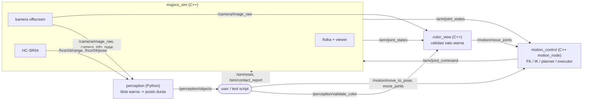

# autonomous_manipulator

Package ROS1 (Noetic) untuk lengan robot 4-DOF dengan gripper berpenggerak gigi yang membangun **piramida 3 + 2 + 1 dari
enam dumbbell** (3 oranye, 2 hitam, 1 beige). Package ini berisi simulasi fisika **MuJoCo**, kinematika dan kontrol
gerak, serta persepsi kamera + sensor jarak HC-SR04. Semua kode kinematika dibaca langsung dari file MJCF, jadi tidak ada angka yang
disalin manual.


*Jendela simulasi. Garis kuning = sinar rangefinder HC-SR04. Inset kanan-bawah = gambar kamera `esp32cam` (tombol `C`
untuk menyembunyikan). Persegi biru = zona tumpukan piramida.*

## Daftar isi

1. [Status](#1-status)
2. [Robot dan scene](#2-robot-dan-scene)
3. [Arsitektur](#3-arsitektur)
4. [Antarmuka ROS](#4-antarmuka-ros)
5. [Dependensi](#5-dependensi)
6. [Instalasi dan build](#6-instalasi-dan-build)
7. [Menjalankan simulasi](#7-menjalankan-simulasi)
8. [Pengujian](#8-pengujian)
9. [Konfigurasi](#9-konfigurasi)
10. [Konvensi](#10-konvensi)
11. [Mode hardware](#11-mode-hardware)
12. [Struktur direktori](#12-struktur-direktori)
13. [Tools](#13-tools)
14. [Troubleshooting](#14-troubleshooting)
15. [Keterbatasan](#15-keterbatasan)
16. [Penulis dan lisensi](#16-penulis-dan-lisensi)

---

## 1. Status

| Fase | Isi | Di repo ini |
|---|---|---|
| 1 | Inspeksi dan validasi model MJCF | Ya (`mjcf/`) |
| 2 | Integrasi MuJoCo + ROS1 (command, state, stepping) | Ya (`mujoco_sim_node`) |
| 3 | FK, IK, Jacobian, batas sendi, trajectory, motion planner | Ya (Python dan C++) |
| 4 | Persepsi: kamera, warna, posisi objek, HC-SR04 | Ya (validasi warna C++, lokalisasi blob Python) |
| 5 | Grasping dan placement | Belum |
| 6 | Misi otonom (state machine, tumpukan piramida) | Belum |
| 7 | Adaptasi hardware | Lihat [bagian 11](#11-mode-hardware) |
| 8 | Validasi di dunia nyata | Belum |

Hasil tes yang sudah dijalankan: isi tabel ini dengan hasil di mesinmu.

| Tes | Hasil |
|---|---|
| `test_joint_control.py` | PASS pada pengecekan target sendi dan gear gripper (dijalankan sebelum cek kontak ditambahkan; jalankan ulang untuk hasil terbaru) |
| `test_kinematics.py` | [ISI] |
| `arm_core_test`, `arm_motion_test`, `arm_color_test`, `arm_view_test` | [ISI] |
| `test_reach_targets.py` | [ISI] |
| `test_perception.py` | [ISI] |

---

## 2. Robot dan scene

### Robot

| Bagian | Spesifikasi |
|---|---|
| Struktur | `joint_1` = yaw (basis); `joint_2`, `joint_3`, `joint_4` = tiga sumbu pitch sejajar (lengan planar 3R) |
| Panjang link | 0,149 m dan 0,211 m; titik alat `grasp_center` 0,095 m di depan `joint_4` |
| Batas sendi | ±1,571 rad untuk keempat sendi |
| Aktuator sendi | 4 × MG996R (disimulasikan sebagai aktuator posisi, kp 4,65, batas gaya 0,93 N·m) |
| Gripper | 1 × MG90S menggerakkan `finger_active`; `finger_passive` digandeng oleh gear (`q_passive = -q_active`) |
| Sensor | Kamera webcam (`esp32cam` di MJCF), HC-SR04 (rangefinder, jangkauan 4 m) |

Lengan hanya memiliki 4 DOF: **posisi (3) + pitch (1)** yang bisa dikendalikan. Yaw alat mengikuti azimut basis dan roll
tetap. Untuk dumbbell yang berdiri di lantai, lengan memakai **cengkeraman samping horizontal** (pitch ≈ 0). Cengkeraman dari atas
tidak mungkin pada jarak itu.

### Scene (`mjcf/scene.xml`)

- **Arena:** setengah lingkaran R = 0,35 m di depan robot; sektor lebih terang = rentang kerja 160°.
- **Enam dumbbell** berdiri tegak, massa 0,03 kg, semuanya pada satu busur r = 0,289 m dari sumbu basis:

| Body | Warna | x [m] | y [m] |
|---|---|---|---|
| `db_black_2` | hitam | 0,1818 | -0,2241 |
| `db_orange_3` | oranye | 0,2420 | -0,1571 |
| `db_beige_1` | beige | 0,2786 | -0,0749 |
| `db_black_1` | hitam | 0,2882 | 0,0146 |
| `db_orange_1` | oranye | 0,2697 | 0,1026 |
| `db_orange_2` | oranye | 0,2249 | 0,1807 |

  Dumbbell: dua pelat 50 × 50 × 10 mm berjarak 40 mm, batang diameter 30 mm, tinggi total 60 mm, titik asal body di tengah
  (z = 0,0305 m saat diam di lantai).
- **Zona tumpukan:** kotak 122 × 60 mm di (0,161, -0,192) dengan yaw 40°, ditandai biru (hanya visual).
- **Keyframe `home`:** pose awal; sendi `[0, 0,8901, 0,35, -0,54]` rad.

---

## 3. Arsitektur



### Node

| Node (nama di launch) | Executable | Bahasa | Fungsi |
|---|---|---|---|
| `mujoco_sim` | `mujoco_sim_node` | C++ | Satu-satunya pemilik `mjModel`/`mjData`. Satu thread: `spinOnce` → `mj_step` → publish → render. Menyediakan joint state, kamera, HC-SR04, monitor kontak. |
| `motion_control` | `motion_node` | C++ | Membungkus library `arm_core` (kinematika, IK, collision checker, planner, executor) sebagai service ROS. |
| `color_view` | `color_view_node` | C++ | Mencari sudut pandang kamera yang hanya menampilkan **satu** warna dumbbell pada posisi yang diberikan, lalu melaporkan warnanya. |
| `perception` | `perception_node.py` | Python | Deteksi blob warna HSV → ray-plane back-projection → posisi dunia, dengan filter arena dan cross-check HC-SR04. |
| *(opsional)* | `motion_control_node.py` | Python | Padanan Python dari `motion_node`; menambah `/motion/go_home`, `/motion/stop`, `/motion/tool_pose`. **Hanya salah satu dari dua node gerak yang boleh berjalan.** |

Library `arm_core` (C++17 murni, tanpa ROS dan MuJoCo) berisi `robot_model`, `kinematics`, `inverse_kinematics`,
`collision_checker`, `trajectory`, `motion_planner`, `executor`, `color_classifier`, `view_planner`, `view_search`. Executor hanya bicara
ke robot lewat antarmuka `RobotInterface`; di simulasi implementasinya adalah topic ROS ke MuJoCo.

---

## 4. Antarmuka ROS

### Topic

| Topic | Tipe | Arah | Keterangan |
|---|---|---|---|
| `/arm/joint_states` | `sensor_msgs/JointState` | sim → semua | 100 Hz. Posisi, kecepatan, dan gaya aktuator semua sendi (`joint_1..4`, `finger_active`, `finger_passive`). |
| `/arm/joint_command` | `sensor_msgs/JointState` | motion_node/tes → sim | Target **posisi** per nama sendi, dibatasi ke `ctrlrange`. Sendi tanpa aktuator (`finger_passive`) diabaikan. Gripper dikendalikan dengan nama `finger_active`. |
| `/camera/image_raw` | `sensor_msgs/Image` | sim → persepsi | `rgb8`, 640 × 480, 15 Hz. Marker site dan sinar rangefinder tidak ikut tergambar. |
| `/camera/camera_info` | `sensor_msgs/CameraInfo` | sim → persepsi | Model pinhole dari `fovy` kamera. |
| `/camera/pose` | `geometry_msgs/PoseStamped` | sim → persepsi | Frame **optik** kamera (x kanan, y bawah, z depan) di frame `world`, stempel sama dengan gambar. |
| `/hcsr04/range` | `sensor_msgs/Range` | sim → persepsi | 20 Hz. `+inf` = tidak ada gema, `-inf` = terlalu dekat (< 2 cm). |
| `/hcsr04/pose` | `geometry_msgs/PoseStamped` | sim → persepsi | Frame site sensor (+z = arah sensor). |
| `/perception/objects` | `autonomous_manipulator/DetectedObjectArray` | persepsi → user | Objek terdeteksi + posisi dunia. |
| `/perception/debug_image` | `sensor_msgs/Image` | persepsi → user | Gambar kamera dengan hasil deteksi digambar di atasnya. |
| `/motion/tool_pose` | `geometry_msgs/PoseStamped` | node Python → user | FK dari sendi terukur, 20 Hz (hanya node gerak Python). |

### Service

| Service | Tipe | Penyedia | Fungsi |
|---|---|---|---|
| `/motion/move_to_pose` | `MoveToPose` | motion node | Gerak ke pose alat di frame dunia; mode `POSE` atau `POSITION`, garis lurus atau joint-space, `dry_run`. Memblokir sampai lengan selesai dan stabil. |
| `/motion/move_joints` | `MoveJoints` | motion node | Gerak joint-space ke target sendi. |
| `/motion/go_home`, `/motion/stop` | `std_srvs/Trigger` | node Python saja | Ke pose home / hentikan gerakan. |
| `/perception/validate_color` | `ValidateColor` | color_view | Cari sudut pandang yang menampilkan satu warna pada `target` dan laporkan warnanya (`UNIQUE`, `AMBIGUOUS`, `NO_OBJECT`, `UNREACHABLE`). |
| `/perception/dump_frame` | `std_srvs/Trigger` | perception | Simpan frame terakhir (mentah + beranotasi) sebagai PNG dan cetak HSV median tiap blob, untuk menyetel ambang warna. |
| `/sim/reset` | `std_srvs/Empty` | sim | Kembali ke keyframe `home`. |
| `/sim/contact_report` | `std_srvs/Trigger` | sim | JSON di `message`: semua kontak yang melibatkan robot sejak panggilan sebelumnya (diperiksa setelah **setiap** `mj_step`), lalu log dikosongkan. |

### Pesan

`DetectedObject`: `color`, `position` (frame dunia, titik tengah blob dipotong dengan bidang `z = object_center_z`),
`pixel_u/v`, `area_px`, `bbox_w_px/h_px`, `range_checked`, `range_ok`, `range_expected`.
`DetectedObjectArray`: `header` (stempel = stempel gambar, `frame_id = world`), `range_measured`, `objects[]`.

### Contoh pemanggilan

```bash
# lengan: gerak horizontal ke dumbbell db_black_1 (garis lurus, pitch dipilih otomatis mendekati 0)
rosservice call /motion/move_to_pose "target: {header: {frame_id: world}, pose: {position: {x: 0.289, y: 0.0, z: 0.0305}}}
mode: 1
prefer_pitch: 0.0
linear: true
duration: 0.0
dry_run: false"

# satu sendi saja
rosservice call /motion/move_joints "{name: [joint_1], position: [0.5], duration: 0.0, dry_run: false}"

# gripper: buka sedikit
rostopic pub -1 /arm/joint_command sensor_msgs/JointState "{name: ['finger_active'], position: [-0.2]}"

# validasi warna dumbbell di posisi (x, y, z) -> field `color` dan `status`
rosservice call /perception/validate_color "{target: {x: 0.288171, y: 0.014557, z: 0.0305}, dry_run: false}"

# reset simulasi, lihat kontak, lihat sensor jarak
rosservice call /sim/reset
rosservice call /sim/contact_report
rostopic echo /hcsr04/range

# lihat gambar kamera dan hasil deteksi
rosrun rqt_image_view rqt_image_view /camera/image_raw
rosrun rqt_image_view rqt_image_view /perception/debug_image
```

---

## 5. Dependensi

### Sistem

| Komponen | Versi yang dipakai |
|---|---|
| Ubuntu | 20.04 |
| ROS | Noetic (catkin, `catkin_make`) |
| Python | 3.8 |
| Compiler | GCC 9.4, **C++17 wajib** (header MuJoCo 3.2.x memakai `std::byte`) |
| CMake | ≥ 3.0.2 (build biasa memakai CMake bawaan ROS) |
| **MuJoCo** | **3.2.7** (hasil build dari source atau rilis resmi; butuh `include/mujoco/mujoco.h` dan `libmujoco.so`) |
| GLFW | 3 (`libglfw3-dev`) |
| Display | X server untuk jendela viewer dan untuk render kamera (lihat [headless](#headless-tanpa-layar)) |

### Paket ROS

`roscpp`, `rospy`, `sensor_msgs`, `geometry_msgs`, `std_msgs`, `std_srvs`, `message_generation`, `message_runtime`.
Untuk melihat hasil: `rqt_image_view` dan `rqt_graph` (sudah ada di `ros-noetic-desktop-full`).

### Paket apt

```bash
sudo apt update
sudo apt install -y build-essential cmake git \
    ros-noetic-desktop-full \
    libglfw3-dev \
    python3-numpy python3-scipy python3-opencv python3-rospkg
```

| Paket | Dipakai oleh |
|---|---|
| `libglfw3-dev` | `mujoco_sim_node` (viewer dan konteks OpenGL kamera) |
| `python3-numpy` | semua modul Python (kinematika, trajectory, persepsi) |
| `python3-opencv` | `perception_node.py` |
| `python3-scipy` | hanya tools offline (`export_robot_model.py`, `make_reference_vectors.py`: convex hull) |
| `python3-rospkg` | `test_perception.py` |
| `mujoco` (pip, opsional) | hanya `tools/mj_probe.py`; **bukan** dependensi runtime |

Kode C++ (`arm_core`, `motion_node`, `color_view_node`) tidak memakai OpenCV; hanya `roscpp` dan `sensor_msgs`.

### MuJoCo 3.2.7

Pilih salah satu.

```bash
# (a) rilis resmi: unduh mujoco-3.2.7-linux-x86_64.tar.gz dari
#     https://github.com/google-deepmind/mujoco/releases lalu:
tar -xzf mujoco-3.2.7-linux-x86_64.tar.gz -C ~          # -> ~/mujoco-3.2.7/{include,lib}

# (b) build dari source (library berakhir di ~/mujoco/build/lib)
sudo apt install -y libgl1-mesa-dev libxinerama-dev libxcursor-dev libxrandr-dev libxi-dev
git clone https://github.com/google-deepmind/mujoco.git ~/mujoco && cd ~/mujoco
git checkout 3.2.7 && cmake -B build -DCMAKE_BUILD_TYPE=Release && cmake --build build -j
```

`CMakeLists.txt` mencari library di `${MUJOCO_DIR}/lib` dan `${MUJOCO_DIR}/build/lib`, jadi kedua cara di atas dikenali.

---

## 6. Instalasi dan build

```bash
mkdir -p ~/catkin_ws/src && cd ~/catkin_ws/src
git clone git@github.com:Timeless-Nata/AUDRION_FP_ABINARA-1.git autonomous_manipulator
cd ~/catkin_ws
source /opt/ros/noetic/setup.bash

# jika MuJoCo ada di ~/mujoco* atau ~/.mujoco/mujoco*, flag boleh dihilangkan
catkin_make -DMUJOCO_DIR=$HOME/mujoco            # atau -DMUJOCO_DIR=$HOME/mujoco-3.2.7
source devel/setup.bash

chmod +x src/autonomous_manipulator/scripts/*.py   # jika izin eksekusi hilang saat clone
```

Build menghasilkan di `devel/lib/autonomous_manipulator/`:
`mujoco_sim_node`, `motion_node`, `color_view_node`, `arm_core_cli`, `arm_core_test`, `arm_motion_test`, `arm_color_test`, `arm_view_test`.

Jika `MUJOCO_DIR` sudah tersimpan di cache CMake dan ingin menggantinya: `rm -f build/CMakeCache.txt` lalu `catkin_make` ulang.

---

## 7. Menjalankan simulasi

```bash
source ~/catkin_ws/devel/setup.bash
roslaunch autonomous_manipulator simulation.launch
```

Launch ini memulai `mujoco_sim`, `perception`, `motion_control` (C++), dan `color_view`.

| Argumen | Default | Fungsi |
|---|---|---|
| `model_path` | `mjcf/scene.xml` di package | File MJCF yang dimuat |
| `render` | `true` | Jendela viewer. `false` = tanpa jendela (kamera tetap jalan lewat jendela tersembunyi) |
| `perception` | `true` | Jalankan `perception_node.py` |
| `motion` | `true` | Jalankan `motion_node` (C++) |
| `color_view` | `true` | Jalankan `color_view_node` (butuh service `/motion/move_joints`) |

```bash
# hanya simulasi + gerak, tanpa persepsi
roslaunch autonomous_manipulator simulation.launch perception:=false color_view:=false

# hanya simulasi (kamu mengirim command sendiri)
roslaunch autonomous_manipulator simulation.launch motion:=false perception:=false color_view:=false
```

### Tombol di viewer

| Tombol | Aksi |
|---|---|
| `Space` | jeda / lanjut |
| `Backspace` | reset ke keyframe `home` |
| `C` | tampilkan / sembunyikan inset kamera |
| `Esc` | keluar |
| Drag kiri / kanan, `Shift`+drag, scroll | putar / geser / bidang lain / zoom kamera |

### Headless (tanpa layar)

`render:=false` tidak membuat jendela terlihat, tetapi render kamera tetap butuh konteks OpenGL. Di server tanpa display:

```bash
sudo apt install -y xvfb
xvfb-run -a roslaunch autonomous_manipulator simulation.launch render:=false
```

### Node gerak versi Python (opsional)

```bash
roslaunch autonomous_manipulator simulation.launch motion:=false          # terminal 1
rosparam load $(rospack find autonomous_manipulator)/config/kinematics_config.yaml /motion_control
rosparam set /motion_control/mjcf_path $(rospack find autonomous_manipulator)/mjcf/scene.xml
rosrun autonomous_manipulator motion_control_node.py                      # terminal 2
```

---

## 8. Pengujian

### Offline (tanpa ROS, tanpa MuJoCo)

```bash
cd ~/catkin_ws/src/autonomous_manipulator
python3 scripts/test_kinematics.py                       # FK, Jacobian, IK, batas sendi, trajectory, jangkauan 6 dumbbell
D=~/catkin_ws/devel/lib/autonomous_manipulator
$D/arm_core_test  config/robot_model.txt test/reference_vectors.txt   # core C++ vs referensi numpy
$D/arm_motion_test config/robot_model.txt                              # trajectory, planner, executor
$D/arm_color_test test/data                                            # classifier warna (gambar sintetis + 2 frame MuJoCo)
$D/arm_view_test  config/robot_model.txt                               # pencarian sudut pandang
```

Semua mengembalikan kode keluar 0 jika lulus.

### Live (butuh `simulation.launch` berjalan)

| Perintah | Yang diperiksa |
|---|---|
| `rosrun autonomous_manipulator test_joint_control.py` | Tiap sendi diberi step ±0,3 rad dan harus mencapai target; gear gripper (`q_passive = -q_active`); **tidak ada kontak** yang menembus lebih dari `--pen-tol` (0,5 mm) selama gerak. |
| `rosrun autonomous_manipulator test_perception.py --sweep` | Deteksi dibandingkan dengan posisi dumbbell di `scene.xml`; opsi `--pose J1 J2 J3 J4` untuk menggerakkan lengan dulu. |
| `rosrun autonomous_manipulator test_reach_targets.py` | FK dibandingkan dengan pose kamera dan HC-SR04 dari MuJoCo; semua dumbbell dijangkau horizontal; kontak diperiksa. **Butuh node gerak Python** (memakai `/motion/go_home` dan param `/motion_control/mjcf_path`), jadi ikuti [langkah node Python](#node-gerak-versi-python-opsional). |

---

## 9. Konfigurasi

Semua di `config/`.

| File | Dipakai oleh | Isi utama |
|---|---|---|
| `simulation_config.yaml` | `mujoco_sim` | `keyframe`, `realtime_factor`, `joint_states_rate`, `render`, `render_rate`, `start_paused`, topic; kamera: `camera_enabled`, `camera_name`, `camera_width/height`, `camera_rate`, `camera_preview`; range: `range_sensor`, `range_rate`, `range_noise_std` |
| `motion_config.yaml` | `motion_node` (C++) | `home_q`, `vmax`, `amax`, `tool_speed`, `control_rate`, `safety_margin`, `collision_margin`, `min_tool_z`, `finger_angle`, `integral_gain`, `settle_*` |
| `kinematics_config.yaml` | node gerak Python | `tool_site`, `home_q`, batas, `gravity_comp`, `payload_kg`, toleransi |
| `color_view_config.yaml` | `color_view` | `min_fraction`, `max_second_ratio`, ROI, `pitch_deg`, `standoffs`, `lateral_steps`, `max_attempts`, `frame_wait` |
| `camera_config.yaml` | `perception` | bagian `hardware` (webcam USB, HSV hasil kalibrasi) dan `simulation` (kamera render, ambang HSV, filter arena, parameter lokalisasi) |
| `hardware_config.yaml` | fase hardware | port serial, mapping servo, pin sensor; semua servo bertanda `calibrated: false` |
| `robot_model.txt` | `motion_node`, `color_view` | Model robot hasil ekspor dari MJCF (digenerate; jangan edit manual) |

Penting:
- `robot_model.txt` **harus digenerate ulang** setiap `arm.xml` berubah: `python3 tools/export_robot_model.py --mjcf mjcf/scene.xml --out config/robot_model.txt`.
- `home_q` di `motion_config.yaml` sama dengan keyframe `home` di `scene.xml`. `home_q` di `kinematics_config.yaml` (node Python) masih nilai lama (`0.4538, -0.4363`); samakan jika memakai node Python.
- Ambang HSV `simulation` di `camera_config.yaml` untuk `perception_node.py` masih untuk scene lama (kuning/hijau/putih), sedangkan scene sekarang memakai oranye/hitam/beige. Kelas warna `color_view` ada di kode (`ColorConfig::simulationDefaults`) dan tidak terpengaruh.

---

## 10. Konvensi

- **Frame:** `world` = frame MJCF; basis robot di (0, 0, 0,017). Satuan: meter dan radian (kecuali argumen pitch pada `arm_core_cli`, derajat).
- **Titik alat:** site `grasp_center`. **Frame alat** (konvensi ROS): x = arah pendekatan gripper, y = kiri, z = atas. Rotasi identitas = gripper horizontal menghadap +x dunia; rotasi **positif** terhadap y membuat gripper **menunduk**.
- **Pitch** = elevasi sumbu x alat (0 = horizontal, negatif = menunjuk ke bawah).
- **Gripper:** `finger_active` rentang -0,873 (paling terbuka) sampai 0,227 (paling tertutup). Rahang berbentuk V: celah di `grasp_center` tidak pernah lebih kecil dari ±38 mm.
- **Servo sim:** aktuator posisi P(D), sehingga ada *sag* gravitasi kecil (sekitar 2,3° di bahu pada pose home) yang dikompensasi `integral_gain` di simulasi. Di hardware servo tidak melaporkan sudut, jadi `integral_gain` harus 0.
- **Collision:** geom `col` (group 3, tidak terlihat) adalah mesh konveks per bagian; geom `vis` (group 1) hanya visual. Pasangan link induk-anak tidak pernah bertabrakan (aturan MuJoCo).

---

## 11. Mode hardware

> **[ISI]** Bagian ini belum bisa dijelaskan dari isi repo ini saja: kode yang mengirim sudut ke STM32 tidak ada di package
> `autonomous_manipulator`. Isi sesuai package/skrip yang kamu pakai (mis. `servo_serial`).

Yang tercatat di `config/hardware_config.yaml`:

| Item | Nilai |
|---|---|
| Mikrokontroler | STM32F103, serial lewat USB-to-TTL: USART2 (TX = PA2, RX = PA3), 115200 baud |
| Servo | `joint_1` PA0 (TIM2_CH1), `joint_2` PA6, `joint_3` PA7, `joint_4` PB0 (TIM3_CH1..3, MG996R); gripper PB1 (TIM3_CH4, MG90S) |
| Konversi | `servo_deg = zero_offset_deg + direction × joint_deg` (default offset 90°; **belum dikalibrasi**) |
| HC-SR04 | TRIG = PB9, ECHO = PB8 |
| Webcam USB | `/dev/video4`, 640 × 480, V4L2 |

Rencana arsitektur: planner dan executor hanya memakai `RobotInterface`, jadi backend hardware cukup menggantikan `RosRobot` di `motion_node`
(servo tidak melaporkan sudut; implementasi mengembalikan nilai terakhir yang diperintahkan).

[ISI: cara menjalankan mode hardware / mode simulasi + hardware sekaligus, nama launch, port serial, urutan kalibrasi]

---

## 12. Struktur direktori

```
autonomous_manipulator/
├── CMakeLists.txt, package.xml, setup.py, CMakeLists_arm_core.txt
├── launch/simulation.launch
├── config/                      parameter (lihat bagian 9) + robot_model.txt
├── mjcf/                        arm.xml (robot), scene.xml (arena, dumbbell, keyframe)
├── meshes/                      STL visual + collision/ (col_*.STL) + arena + dumbbell_plate
├── msg/                         DetectedObject, DetectedObjectArray
├── srv/                         MoveToPose, MoveJoints, ValidateColor
├── include/autonomous_manipulator/   header library arm_core
├── src/
│   ├── simulation/mujoco_sim_node.cpp
│   ├── control/                 arm_core + motion_node + color_view_node
│   ├── tools/arm_core_cli.cpp   CLI: fk / collide / ranges / ik / ikpos
│   └── autonomous_manipulator/  paket Python: kinematics, trajectory, motion_control
├── scripts/                     perception_node.py, motion_control_node.py, test_*.py
├── test/                        test C++, reference_vectors.txt, data/ (frame simulasi PPM)
├── tools/                       export_robot_model.py, make_reference_vectors.py, mj_probe.py
└── PHASE3.md                    catatan rinci kinematika dan kontrol gerak
```

---

## 13. Tools

| Tool | Fungsi |
|---|---|
| `tools/export_robot_model.py` | Mengubah MJCF menjadi `config/robot_model.txt` (pohon body, convex hull collision, frame bernama). Jalankan ulang setelah mengubah `arm.xml`. |
| `tools/make_reference_vectors.py` | Membuat `test/reference_vectors.txt` dengan implementasi numpy independen untuk memvalidasi core C++. |
| `tools/mj_probe.py` | (butuh `pip install mujoco`) Meletakkan lengan di pose tertentu dan mencetak `grasp_center` serta semua kontak. |
| `arm_core_cli` | `arm_core_cli config/robot_model.txt fk q1 q2 q3 q4`, juga `collide`, `ranges`, `ik x y z pitch_deg`, `ikpos x y z`. |

---

## 14. Troubleshooting

| Gejala | Penyebab dan solusi |
|---|---|
| `libmujoco.so not found in .../lib` | Library ada di `build/lib` (build dari source) atau `MUJOCO_DIR` salah. Beri `-DMUJOCO_DIR=<folder yang berisi include/mujoco/mujoco.h>`, hapus `build/CMakeCache.txt`, build ulang. |
| `'byte' is not a member of 'std'` | Compiler memakai C++14. Package ini memerlukan `-std=c++17` (sudah diset di `CMakeLists.txt`). |
| `Error: keyframe 0: invalid qpos size, expected length N` | Jumlah angka `qpos` keyframe tidak sama dengan 6 (sendi lengan) + 7 × jumlah body bebas. |
| Link lengan tampil sebagai bola abu-abu | Class default `vis` dan `col` di `arm.xml` harus memuat `type="mesh"`; tanpa itu MuJoCo memasang bola yang dicocokkan ke mesh. |
| Beberapa sendi tidak mencapai target di `test_joint_control.py` | Geom collision menahan sendi; periksa dengan `--pen-tol` dan `/sim/contact_report`. |
| `glfwCreateWindow failed` / tidak ada gambar kamera | Tidak ada display. Gunakan `xvfb-run -a roslaunch ...`. Tanpa konteks GL, joint state dan HC-SR04 tetap jalan tetapi kamera tidak. |
| Peringatan `camera ... exceeds the offscreen buffer` | Tambahkan `<visual><global offwidth="W" offheight="H"/></visual>` ke MJCF, atau perkecil `camera_width/height`. |
| `test_reach_targets.py` menunggu `/motion/go_home` lalu gagal | Node gerak C++ tidak menyediakan `go_home` dan param `mjcf_path`. Pakai node Python ([langkah di bagian 7](#node-gerak-versi-python-opsional)). |
| `busy: another motion is running` | Service gerak memblokir selama lengan bergerak; tunggu panggilan sebelumnya selesai. |
| Posisi alat meleset beberapa mm | Dead-band gesekan servo sim (≈ 4 mrad) membatasi akurasi sekitar 1–2 mm; `integral_gain` menyesuaikan sag gravitasi. |
| Deteksi `perception_node.py` kosong | Ambang HSV `simulation` di `camera_config.yaml` untuk warna scene lama; setel ulang dengan `/perception/dump_frame`. |

---

## 15. Keterbatasan

- Collision avoidance planner terbatas pada link lengan terhadap dirinya dan lantai (cek ketinggian). Dumbbell **bukan** penghalang di planner; kontak dengan dumbbell hanya dilaporkan oleh `/sim/contact_report`.
- IK mencakup lengan di depan sumbu basis (alat menjauhi basis); pose terlipat ke belakang di luar cakupan.
- Hanya pitch yang bisa dikendalikan; yaw alat mengikuti azimut basis dan roll tetap.
- `color_view` tidak mengestimasi posisi: pemanggil memberi posisi dumbbell, kamera hanya memvalidasi warna.
- Kamera dan HC-SR04 di simulasi ideal (tanpa noise kecuali `range_noise_std` diisi).
- Belum ada grasping, stacking, state machine misi, dan backend hardware di package ini.

---

## 16. Penulis dan lisensi

[ISI: nama tim, kontak, institusi]

Lisensi: MIT (sesuai `package.xml`). Pastikan file `LICENSE` ditambahkan ke repo.
